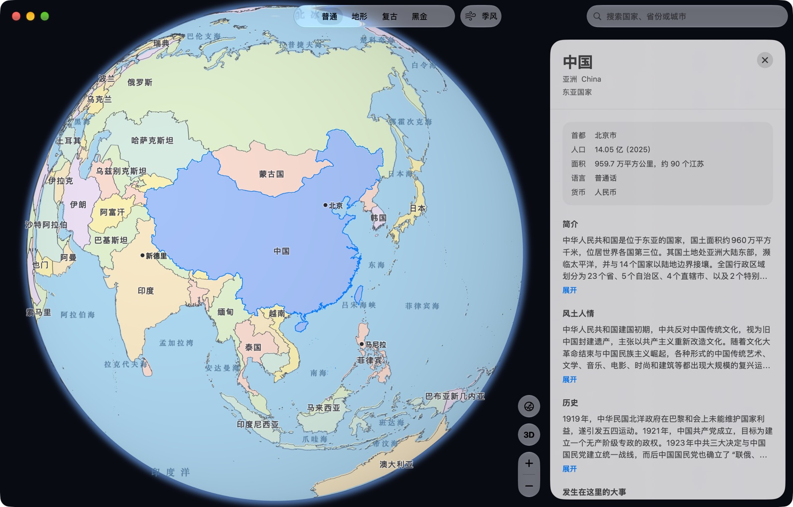
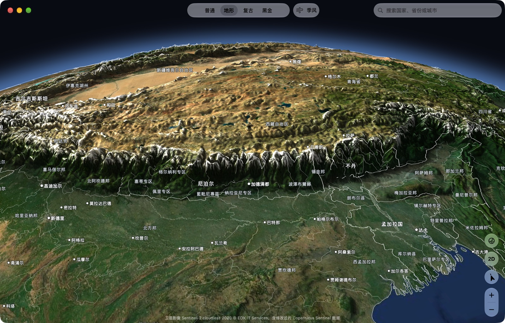
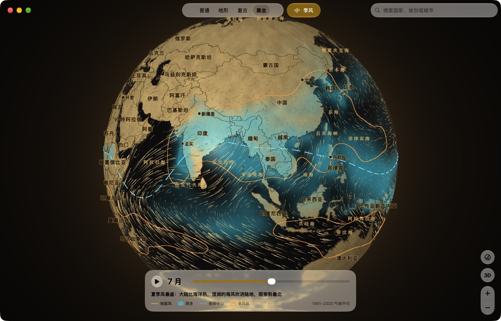
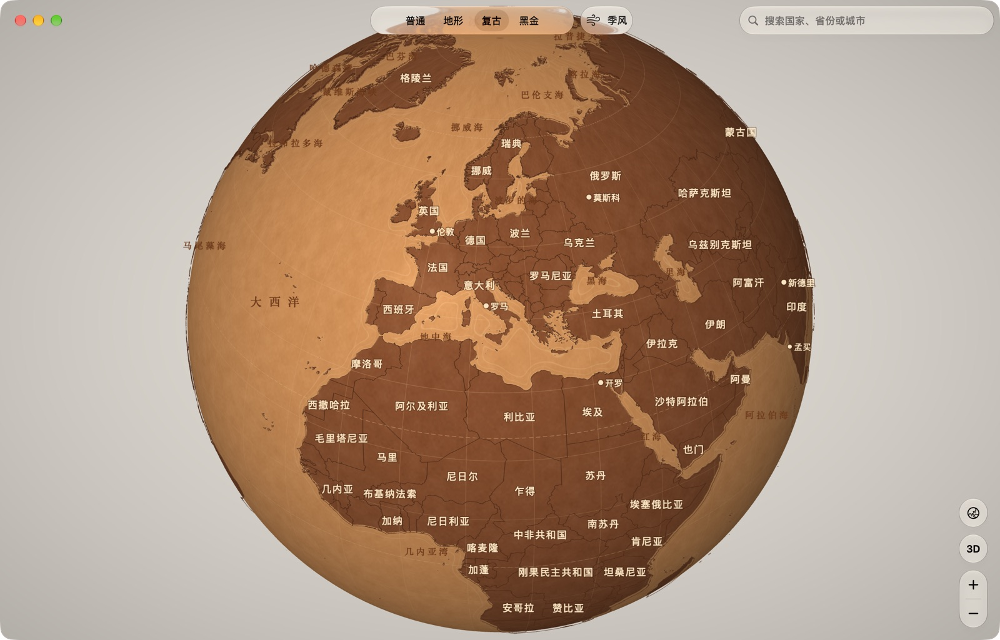

# 山海

原生 macOS 地球仪：点一下任何国家或省份，看它的介绍、风土人情、历史大事和名人。全部数据离线打包，不联网。

A native macOS globe in Chinese. Click any country or province to read about it. Fully offline. Custom Metal renderer.



## 功能

- **四种风格**：普通（政区图）、地形（卫星影像加立体浮雕）、复古（焦糖皮面地球仪）、黑金（黑漆金箔）。
- **3D 地形**：倾斜视角看山脉起伏，晕渲、山体投影、环境光遮蔽都在着色器里实时算。
- **点选到省级**：全球 4468 个省级区；远看选国家，放大后选省。
- **右侧介绍**：基本资料、简介、风土人情、历史、发生在这里的大事、出生或活跃在这里的名人。
- **季风模拟**：逐月地面风粒子、降水、季风区、雨带中心线，可播放、可拖动月份。
- **搜索**：国家、省份、城市，选中后飞过去。

| 地形 3D | 黑金加季风 | 复古 |
|---|---|---|
|  |  |  |

## 系统要求

macOS 26，Apple 芯片。界面只有中文。

## 构建

仓库里有代码、着色器、内容和大部分地理数据。四张 16K 底图（`*.ktx`，每张约 90 MB）太大，不入库，要在本机生成：

```sh
brew install xcodegen
python3 -m venv scripts/.venv && scripts/.venv/bin/pip install -r scripts/requirements.txt
scripts/fetch_raw.sh                         # 下载原始数据到 data/raw/，约 2 GB
scripts/.venv/bin/python scripts/build_geo.py       # 边界、ID 栅格、高程、城市、政区底图
scripts/.venv/bin/python scripts/build_imagery.py   # 四张底图压成 BC1 KTX（需要 Xcode）
scripts/.venv/bin/python scripts/build_climate.py   # 季风数据（仓库里已有，可跳过）
scripts/install.sh                           # 构建 Release，装到 /Applications/山海.app
```

`build_content.py` 会从中文维基百科和 Wikidata 重新抓取介绍内容，跑一遍要几个小时；仓库里已经带了生成好的 `Shanhai/Resources/Content/`。

着色器在运行时编译（`Shaders.msl`），不需要单独装 Metal 工具链。

## 数据来源与许可

| 数据 | 来源 | 许可 |
|---|---|---|
| 国界、省界、城市、海洋名 | Natural Earth（中国视角国界） | 公有领域 |
| 卫星影像 | Sentinel-2 cloudless 2020，EOX IT Services | CC BY-NC-SA 4.0，仅限非商业 |
| 卫星影像缺块与极区补图 | Natural Earth I | 公有领域 |
| 高程 | AWS Terrain Tiles（Mapzen） | 见其 [署名要求](https://github.com/tilezen/joerd/blob/master/docs/attribution.md) |
| 介绍文字 | 中文维基百科 | CC BY-SA 4.0 |
| 事实、名人、事件 | Wikidata | CC0 |
| 地面风 | NCEP/NCAR 再分析，NOAA PSL | 公有领域 |
| 降水 | GPCP v2.3，NOAA PSL | 公有领域 |

卫星影像的署名显示在地形视图底部，维基百科的署名显示在介绍面板底部。

Sentinel-2 cloudless 影像只允许非商业使用。由它生成的 `physical.ktx` 不随仓库分发；如果你分发自己构建的 App，也要遵守这一条。

## 许可

代码以 [GPL-3.0](LICENSE) 发布。提交 PR 前请阅读并同意 [CLA](CLA.md)。数据按上表各自的许可。
